  

## 📫 CONTACT

  
  
  
  
  
  

---

<table>
<tr>
<td width="40%" align="center" valign="top">
  
   <code>LOCATION: HO CHI MINH CITY, VN</code>
   <code>Uptime since 2005</code>
</td>
<td width="60%" valign="top">

### 🙋 ABOUT ME

I'm an **Embedded Software Engineer** with a background in **Computer Engineering from HCMUTE**, working across **microcontrollers, embedded firmware, and FPGA**, the space where hardware meets software.

I enjoy working with real boards and digging into why something doesn't behave as expected, because understanding things down to the low level is what makes firmware **reliable and predictable**. Outside of work, you'll usually find me behind a camera.

  
  

</td>
</tr>
</table>

---

<table>
<tr>
<td width="60%" valign="top">

### 📖 MY STORY | MENVO

Born in **2005 in Dong Thap**, I grew up loving geometry, which led me to the **math olympiad team** in middle school and the **specialized math class at Nguyen Dinh Chieu High School for the Gifted**. At the same time, I was tinkering with **handmade electronics**, a passion that brought me to **Computer Engineering at HCMUTE**.

**Currently**, I'm learning **STM32 and the AK event-driven framework** through the AK Foundation training program, along with **FreeRTOS** and **wireless sensor networks** on the Raspberry Pi Pico 2 W, aiming to build a solid foundation in embedded programming.

<i>"Every bug has a reason. You just have to keep digging until you find it."</i>

</td>
<td width="40%" align="center" valign="top">
  
   <i>// snapshot_02: off-duty mode</i>
</td>
</tr>
</table>

---

## 🛠️ TECH STACK

### LANGUAGES

### HARDWARE & PLATFORMS

   

### EMBEDDED & PROTOCOLS

     

### TOOLS

  

---

## 📊 GIT STATS

  

  
  

---

## 👾 CONTRIBUTION GRAPH

<picture>
  <source media="(prefers-color-scheme: dark)" srcset="https://raw.githubusercontent.com/menvo-info/menvo-info/output/pacman-contribution-graph-dark.svg">
  <source media="(prefers-color-scheme: light)" srcset="https://raw.githubusercontent.com/menvo-info/menvo-info/output/pacman-contribution-graph.svg">
  
</picture>

---

  

© 2026 VO NGOC MEN

